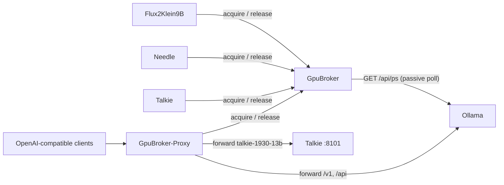

# GpuBroker

GpuBroker coordinates VRAM on a host with one GPU and several local
inference services. It has two parts. The broker tracks a VRAM budget.
The proxy gates OpenAI-compatible traffic through that budget.

## Why it exists

A single GPU cannot fit every model at once. Flux2Klein9B, Needle,
Ollama, and Talkie share one RTX 4070 on this host. Without
coordination, two services can load at the same time. One then runs
out of memory.

GpuBroker is not a proxy in the GPU data path. Clients still talk to
CUDA or XLA directly. The broker is a gatekeeper. A client asks for a
VRAM lease before it loads weights. It releases the lease once it
evicts them.



## GpuBroker (this folder)

A FastAPI service holds a lease ledger. It answers one question: does
a new request fit in the remaining VRAM budget?

Grant a request of size `mb` when:

```
reserved_mb + ollama_mb + requested_mb <= budget_mb
```

`budget_mb` is `gpu_total_mb` minus the live safety margin.
The margin is the p95 of unlocked non-lease samples once enough exist.
Until then it is `GPU_SAFETY_MARGIN_MB`.
The result is never below `GPU_SAFETY_MARGIN_MIN_MB`.
`reserved_mb` is the sum of active leases. `ollama_mb` comes from a
passive poll of Ollama `/api/ps`. This project does not modify the Ollama Go source.
Live `nvidia-smi` usage does not gate admission. The broker still
reads it. If live use exceeds the margin plus reserved plus Ollama,
the broker logs a warning. Including live use in the gate charged the
idle baseline twice. That bug is recorded in
`Assist/ISSUE_double_counted_margin.md`.

The ledger persists to `GPU_BROKER_LEDGER_PATH` with an atomic write.
A broker restart does not lose an active lease. Restored leases get
`last_seen` reset to now. The sweeper then leaves a healthy pre-restart
lease in place. `/acquire` is idempotent by caller name. Fairness uses a
monotonic sequence number per pending `/acquire`. Only the lowest
pending sequence may be granted. A zero-size request (`mb=0`) does not
join that queue. It is granted whenever the ledger is within budget, so
a large waiter that cannot fit does not block it.

A `/acquire` that times out returns 504 with `Retry-After: 10`. A
consumer should sleep at least that long, back off exponentially, and
retry. The broker keeps the caller's fairness wait age for 120 s after a
504 (`WAITER_MEMORY_SECONDS`). A caller that keeps retrying therefore
ages past an idle preemptible holder of the same tier after about 90 s.
The broker then flags that holder, and the retry after it releases gets
the lease.

`timeout_s` must be finite and at most 600 s. `caller` must be 1 to 128
characters. Invalid `mb`, `timeout_s`, `pid`, or `caller` returns 422.
A request larger than the GPU can ever grant also returns 422. That
bound is GPU total minus the safety-margin floor. The request does not
join the FIFO. `/release` and `/heartbeat` reject a `lease_id` longer
than 64 characters with 422.

The broker admits at most 64 active leases. A new grant past that cap
returns 503 with detail `too_many_leases` and `Retry-After: 5`. A
caller that already holds a lease still gets that lease back.

The broker scans host processes before each `/acquire` and once per
second. A running Steam Proton game has a `steam-launch-wrapper` process
with `SteamLaunch AppId=N` and a `proton` argument. The wrapper must be
owned by the same user as the broker. In the rootless container that
user is the desktop user. Other local users cannot trigger the block.
The broker refuses all new leases as soon as it detects this process.
It keeps the block for 30 minutes after the process exits, including
across broker restarts.
`/status` shows `proton_game_active` and
`proton_game_retry_after_seconds`. The Steam client alone does not
activate this block. Native games without Proton need the VRAM detector.

Samples taken while a Proton game runs are excluded from the safety
margin percentile, even if the game uses less than the VRAM threshold.

Heavy unmanaged VRAM use also blocks every new `/acquire`. The broker
returns 503 with detail `unmanaged_gpu_load` and `Retry-After`: 120
seconds for heavy VRAM use, or the remaining Proton block if longer.
Preemptible holders get `preempt: true` on their next heartbeat. Existing
leases can be deduplicated; no new memory is admitted. Clients must not
load on a 503. The VRAM detector subtracts container GPU process use
from live `nvidia-smi` use. If that scan fails, it falls back to live
use minus leases and Ollama.

CORS is GET-only. A dashboard on another origin can poll `GET /status`.
The browser then refuses preflight for POST routes, including
`/admin/clear`. CORS is not a substitute for `GPU_BROKER_ADMIN_TOKEN`.
`TrustedHostMiddleware` allows `localhost`, `127.0.0.1`, `::1`, and
`host.containers.internal`. Extra names go in `GPU_BROKER_ALLOWED_HOSTS`.
A disallowed Host returns 400.

| Method | Path | Purpose |
| --- | --- | --- |
| POST | `/acquire` | Request a VRAM lease. `caller` is 1 to 128 characters. Blocks until admitted or `timeout_s` expires (cap 600 s), then returns 504. Returns 422 for invalid input or a request larger than the GPU can ever grant. Returns 503 with `Retry-After` while a game holds the GPU. Returns 503 with detail `too_many_leases` and `Retry-After: 5` when 64 leases are already active. |
| POST | `/release` | Release a lease. |
| POST | `/heartbeat` | Keep a lease alive. The sweeper reclaims a lease that misses a heartbeat within `GPU_BROKER_LEASE_TTL_SECONDS`. |
| POST | `/admin/clear` | Kill every GPU compute process `nvidia-smi` lists except the broker itself, including processes no lease owns (games, desktop renders, host Talkie). Then reset all leases. Call with `dry_run: true` first and review `would_kill`. Disabled unless `GPU_BROKER_ADMIN_TOKEN` is set. Needs `pid: host`. |
| GET | `/status` | Budget, leases, VRAM game-detector state, Steam Proton process state, and cooldown seconds. |
| GET | `/health` | Liveness check. |

## GpuBroker-Proxy (`GpuBroker-Proxy/`)

A stateless reverse proxy in front of the full Ollama API. That includes
native `/api/*` endpoints and the OpenAI-compatible `/v1/*` subset. It
also routes named models to other backends from `registry.json`. It
never changes a request or response body.

Current registry entries:

- `talkie` at `http://host.containers.internal:8101` for model
  `talkie-1930-13b`
- `freetoken` at `http://host.containers.internal:1919` for model
  `ornith-1.5-35b-a3b`
- `ollama` at `http://ollama:11434`, the default for unmatched models

A request that names a model requests a broker lease (`mb=0`) before
the proxy forwards it. `POST /api/show` is the exception. That path is
Ollama model metadata and does not load weights. The proxy still routes
it by model, but skips acquire and release. The proxy releases a gated
lease once the response finishes. The lease size is zero because the
broker already tracks Ollama through `/api/ps`. The zero-size request
skips the broker's fairness queue but is still refused while a game
holds the GPU.

If a zero-size lease expires, the watchdog removes it from the ledger.
It does not queue a GPU termination warning for that caller. Positive-size
leases still get a one-shot warning on the caller's next grant.

The watchdog `pid` may be a host pid or the caller's container-namespace pid.
The sweeper signals only a GPU compute process that runs in a container.
A host match or an ambiguous match removes the lease. It sends no signal.

While a leased response streams, the proxy POSTs `/heartbeat` every
60 s (one third of the 180 s lease TTL). A heartbeat HTTP failure
logs a warning and the stream continues. The proxy ignores `preempt`
because a zero-size lease holds no VRAM. If the broker returns
`ok: false`, the proxy logs a warning once and stops heartbeats.

A request with no `model` field passes through without the broker.
Examples: `GET /api/ps`, `GET /v1/models`.

A request body larger than 64 MiB returns HTTP 413. The proxy checks
`Content-Length` first. It also counts bytes while it reads a chunked
body. A 413 does not call the broker.

If the broker denies a request, the proxy returns HTTP 429 with
`Retry-After`. A 504 (no room) maps to `GPU busy, retry later`. A 503
with detail `unmanaged_gpu_load` maps to `GPU reserved for unmanaged
load, retry later`. Detail `too_many_leases` maps to `broker lease
limit reached, retry later`. Any other 503 maps to `GPU broker
refused admission, retry later`. The proxy copies the broker
`Retry-After` when the broker sent one. A 503 never fails open. If
the broker is unreachable, the proxy fails open by default
(`BROKER_FAIL_OPEN=true`) and forwards the request unmetered.

`GET /v1/models` returns only the default backend list (Ollama). A
GET has no body, so the proxy cannot route by model. Clients that need
the Talkie model list should query `:8101` directly.

The Dockerfile copies `registry.json` into the image at build time. A registry
change needs `podman compose up -d --build`, not a restart.

## Quick usage

Full install steps live in `SETUP.md`. The short path for the broker:

```bash
cp .env.example .env
# Set GPU_SAFETY_MARGIN_MB from a real measurement first.
podman compose up -d
curl http://localhost:8792/health
```

The proxy is a second compose project in `GpuBroker-Proxy/`. It takes
over host port 11434 from Ollama.

## Client integration

A tightly-integrated client calls `POST /acquire` with
`{caller, mb, timeout_s}` before it loads weights. It calls
`POST /release` once it evicts them. It calls `POST /heartbeat` on an
interval while the lease is held.

Copy `TI-Template/async_broker_client.py` or
`TI-Template/sync_broker_client.py` into the service. See
`TI-Template/README.md` for the wiring checklist.

`examples/` has runnable patterns: a minimal lease request and release,
a long-running service with idle eviction, 504 handling, and
post-admission OOM. Size `mb` from measured peak use, not from static
weight size. See `examples/sizing_a_request.md`.

Flux2Klein9B and Needle are the production async and sync references.
Both fail open on a broker connection error when
`BROKER_FAIL_OPEN=true`. Both fail closed on an explicit denial.

## Testing

```bash
python3 -m pytest tests/
python3 -m pytest GpuBroker-Proxy/tests/
```

Tests mock `nvidia-smi` and HTTP. They do not need a live GPU.

## Project layout

```
.
|-- server.py              # Broker service
|-- docker-compose.yml     # Broker container
|-- .env.example           # Broker environment template
|-- SETUP.md               # Install and deploy
|-- STATE_OF_THE_PROGRAM.md
|-- GpuBroker-Proxy/       # Reverse proxy (own compose project)
|   |-- server.py
|   `-- registry.json      # model -> backend routing table
|-- TI-Template/           # Copy-paste acquire/release/heartbeat clients
|-- examples/              # Runnable client patterns
`-- tests/                 # Unit tests, no live GPU required
```
