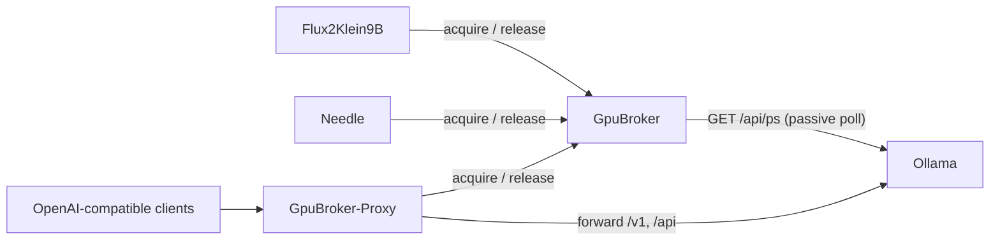

# GpuBroker

GpuBroker coordinates VRAM use on a host with one GPU and several local
inference services. It has two parts: a broker that tracks a VRAM budget,
and a proxy that gates OpenAI-compatible traffic through that budget.

## Why it exists

A single GPU cannot fit every model at once. Flux2Klein9B, Needle, and
Ollama on this host share one card. Without coordination, two services can
load at the same time and one runs out of memory.

GpuBroker is not a proxy in the GPU data path. Clients still talk to
CUDA or XLA directly. The broker is a gatekeeper: a client asks for a VRAM
lease before it loads weights, and releases the lease once it evicts them.



## Components

### GpuBroker (this folder)

A FastAPI service that holds a lease ledger and answers one question: does
a new request fit in the remaining VRAM budget?

Admission formula: grant a request of size `mb` when

```
max(nvidia_smi_used_mb, reserved_mb + ollama_mb) + mb <= budget_mb
```

`budget_mb` is `gpu_total_mb` minus a configured safety margin. `reserved_mb`
is the sum of active leases. `ollama_mb` comes from a passive poll of
Ollama's own `/api/ps`, since Ollama's Go source is out of scope and not
modified to cooperate.

Endpoints:

| Method | Path | Purpose |
| --- | --- | --- |
| POST | `/acquire` | Request a VRAM lease. Blocks and retries until admitted or `timeout_s` expires, then returns 504. |
| POST | `/release` | Release a lease. |
| POST | `/heartbeat` | Keep a lease alive. A lease not heartbeated within `GPU_BROKER_LEASE_TTL_SECONDS` is reclaimed by a sweeper. |
| GET | `/status` | Current budget, reserved MB, Ollama MB, live `nvidia-smi` usage, and the full lease ledger. |
| GET | `/health` | Liveness check. |

The ledger persists to `GPU_BROKER_LEDGER_PATH` with an atomic write, so a
broker restart does not lose an active lease.

### GpuBroker-Proxy (`GpuBroker-Proxy/`)

A stateless reverse proxy in front of Ollama's full API, both its native
`/api/*` endpoints and its OpenAI-compatible `/v1/*` subset. It routes each
request by a `model` field to a backend from `registry.json`, and it never
changes a request or response body.

A request that names a model acquires a broker lease (`mb=0`) before the
proxy forwards it, and releases the lease once the response finishes. The
lease size is zero because the broker already tracks Ollama's footprint
through its own passive `/api/ps` poll. The zero-size acquire call still
does its job: it gives the request a turn in the broker's fairness queue,
so an Ollama request waits behind a real VRAM hold instead of firing into a
full GPU.

A request with no `model` field, such as `GET /api/ps` or `GET /v1/models`,
is metadata or management traffic, not generation work. It passes straight
through without touching the broker.

If the broker denies a request (no room within `BROKER_ACQUIRE_TIMEOUT_S`),
the proxy returns HTTP 429 with a `Retry-After` header. If the broker is
unreachable, the proxy fails open by default (`BROKER_FAIL_OPEN=true`) and
forwards the request unmetered, rather than blocking all traffic on one
broker outage.

The registry supports more than one backend. Add an entry to
`registry.json` to route a specific model to a different service. No proxy
code change is needed for that.

## Setup

Each component is its own compose project.

```bash
# Broker
cp .env.example .env
# Set GPU_SAFETY_MARGIN_MB from a real measurement first (see .env.example).
podman compose up -d

# Proxy (optional, only if you route Ollama traffic through GpuBroker)
cd GpuBroker-Proxy
cp .env.example .env
podman compose up -d
```

The proxy takes over port 11434 from Ollama. Remove the host port publish
from Ollama's own compose file and join it to the same `ollama_default`
network the proxy uses, so the proxy can still reach it by service name.

### Measuring the safety margin

`GPU_SAFETY_MARGIN_MB` is not a guess. Stop every GPU client, including
Ollama, and run:

```bash
nvidia-smi --query-gpu=memory.used --format=csv,noheader,nounits
```

That number, plus a small buffer, is the margin.

## Client integration

A client that wants a VRAM lease calls `POST /acquire` with `{caller, mb,
timeout_s}` before it loads weights, then `POST /release` once it evicts
them, and `POST /heartbeat` on an interval while the lease is held. See
`Flux2Klein9B/server.py` and `Needle/server.py` for the async and sync
reference implementations. Both fail open on a broker connection error and
fail closed on an explicit denial.

## Testing

```bash
cd GpuBroker && python3 -m pytest tests/
cd GpuBroker-Proxy && python3 -m pytest tests/
```

## Project layout

```
.
├── server.py                # Broker service
├── GpuBroker-Proxy/
│   ├── server.py             # Reverse proxy
│   └── registry.json         # model -> backend routing table
├── docs/overview.md          # Module map and endpoint reference
├── plan.md                   # Design notes and rationale
└── tests/                    # Unit tests, no live GPU required
```
